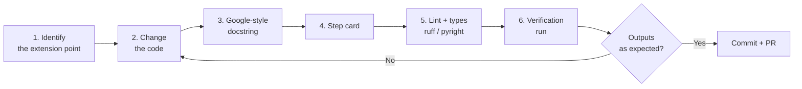

# Modify a pipeline step

This page answers the contributor's question: **how to change the
behaviour, test the change and keep the documentation consistent?**

## Six-step workflow



## 1. Identify the extension point

Typical changes and where to make them:

| You want to... | Extension point | Reference card |
|---|---|---|
| Add an INSEE quality check | Class in `acquisition/suppliers/insee/checks/` inheriting `DataValidationAndConsistencyInseeCog`, referenced in `download_cog_data` | [01](../explanation/steps/01-download-insee-cog.md) |
| Add a LaPoste check | Class in `acquisition/suppliers/laposte/checks/` | [02](../explanation/steps/02-download-laposte.md) |
| Change metropolitan France semantics | `_correct_record_metropolitan_france_dummy` | [03](../explanation/steps/03-metropolitan-france-correction.md) |
| Add a typology | `LocationRule` in `compute_location_typologies` | [04](../explanation/steps/04-communes-typology.md) |
| Change postal code attribution | `path_to_leaf_is_unique_in_and_out` / `get_postal_codes_historical_geo_entity` | [05](../explanation/steps/05-postal-codes-merge.md) |
| Tolerate a one-off anomaly | **Do not code it**: declare an exception in the YAML | [Handle exceptions](../how-to/handle-exceptions.md) |

## 2. Respect the code invariants

- A check never fails silently: `RuntimeError` with URI, row and violated
  rule.
- SQL lives in a `*.mustashe.sql` template, never concatenated in Python.
- Every loaded dataset is declared in `InfoCurrentStoredData`.
- An enrichment function must stay robust to a clean working directory (no
  global state between runs).

## 3. Test the change

```bash
poetry run ruff check .
poetry run pyright
poetry run geo_data_collector \
    --acquisition-config-file config/config-acquisition.yaml \
    --exceptions-handler-config-file config/config-exceptions-handler.yaml \
    --working-directory /tmp/check --overwrite-working-directory
```

The project has no test suite yet: the minimal verification is a complete
run on a throwaway directory, with inspection of the modified step's CSVs
(commands given in each card, section 3).

## 4. Document the change

See [Update the documentation](update-documentation.md) — a mandatory
checklist before any PR.

## 5. Before the PR

```bash
poetry run mkdocs build --strict   # the documentation must compile
```

The repository's GitHub Action rebuilds the site on every push to `main`:
a site that does not compile blocks the publication.
