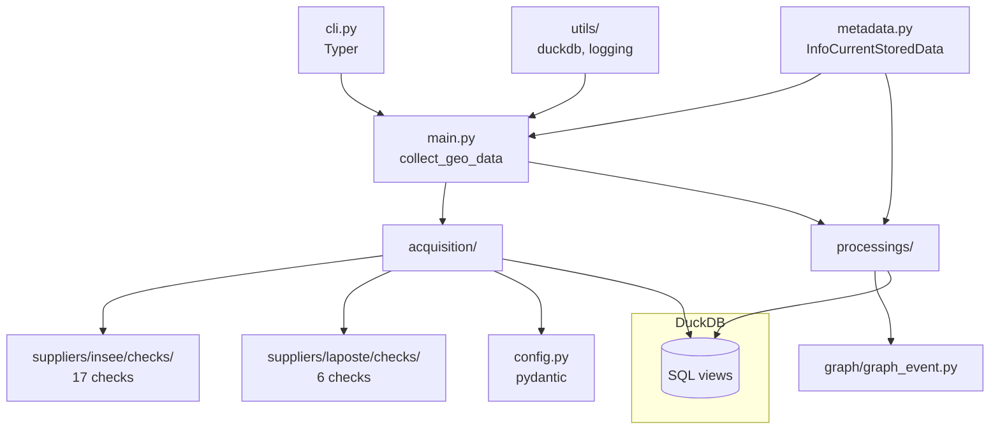
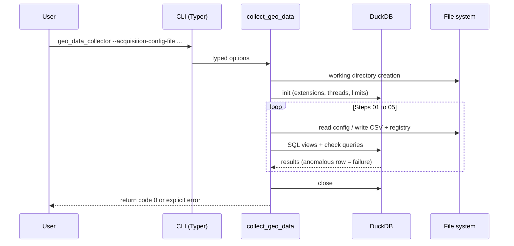

# Technical architecture

This page answers the developer's question: **how is the code organised,
what are the data flows and dependencies?**

## Module overview

## Role of each module

| Module | Responsibility |
|---|---|
| `cli.py` | Typer boundary: command-line options → `main.collect_geo_data` |
| `main.py` | Pipeline orchestration, working directory management, clean connection shutdown |
| `acquisition/config.py` | pydantic models `AcquisitionConfig` / `ErrorHandlerConfig` + YAML/JSON loading |
| `acquisition/suppliers/{insee,laposte}/requests.py` | HTTP/SPARQL requests per entity type, raw CSV writing |
| `acquisition/suppliers/{insee,laposte}/checks/` | Post-download quality checks (`Check*` classes) |
| `processings/` | The five enrichment steps (`download_*`, `*_correction`, `communes_typology`, `postal_codes_merge`) |
| `graph/graph_event.py` | `igraph` event graph built from the DuckDB views |
| `metadata.py` | Registry of loaded data (`InfoCurrentStoredData`) and column typing (`ColumnDataType`) |
| `utils/duckdb.py` | DuckDB connection setup (ICU/JSON extensions, memory/thread limits) |

## Data flow of a run

## Design invariants

1. **Fail loudly**: a failing quality check stops the pipeline with a full
   error message (entity URI, row, violated rule).
2. **Central registry**: every loaded dataset is declared in
   `InfoCurrentStoredData` with its metadata (path, typed columns);
   downstream steps only read this registry.
3. **Queries in templates**: SQL lives in `.mustashe.sql` files rendered by
   pystache — never SQL concatenated in Python.
4. **A single graph**: steps 03, 04 and 05 build the event graph through
   the same function
   [`build_history_graph_of_geo_entities`](../reference/graph.md).

## Documentation / code correspondence

The documentation is tied to the code through mkdocstrings: the
[reference](../reference/acquisition.md) pages embed Python objects
directly (`::: rnipp_geo_data_collector...`). Updating a docstring therefore
propagates automatically to the site; step cards describe business rules and
link to the reference.
