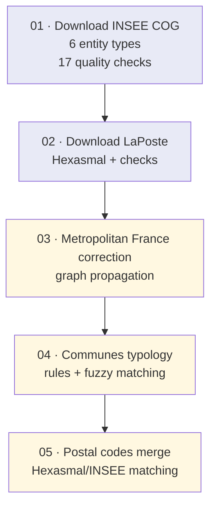

# Process methodology

This page answers the user's question: **why is the process structured this
way, and how do parameters influence the results?**

## The need

Reconstructing the history of French geographic entities requires
reconciling two heterogeneous sources:

- the **INSEE COG** (Code officiel géographique), served through a SPARQL
  endpoint: the legal reference of entities and their validity dates;
- **LaPoste Hexasmal**: the operational reference of postal codes, attached
  to commune labels (not to INSEE codes).

The central problem is **matching**: linking a postal label to a dated
INSEE entity, knowing that both sources evolve in parallel (commune merges,
renamings, shared postal codes).

## The five steps and their rationale

| Step | Design decision | Rejected alternative |
|---|---|---|
| 01–02 Acquisition validated *before* any enrichment | Never build on unvalidated data: every check fails loudly (explicit failure) | Fix issues on the fly along the pipeline — makes anomalies silent |
| 01–02 Declarative exceptions (YAML) | Known COG anomalies are documented management decisions, not code | Hard-coded exceptions — not auditable |
| 03–05 Shared event graph | "Who existed when", "who descends from whom" questions are graph traversals; a single model serves all three steps | Recursive SQL — unreadable and rewritten at every step |
| 04–05 Fuzzy matching (rapidfuzz) with thresholds | Postal label/INSEE matching tolerates spelling, hyphens, accents | Strict equality — matching rate too low |

## How parameters influence the results

- **Configuration files** (`--acquisition-config-file`,
  `--exceptions-handler-config-file`): change *what is collected* and *which
  anomalies are tolerated*. This is the first lever.
- **Performance** (`--threads`, `--duckdb-memory-limit`): never change the
  content of the outputs, only the speed and the footprint.
- **Working directory** (`--working-directory`): every step writes to its own
  numbered sub-directory (`01_processing` ... `05_processing`) — runs are
  reproducible and every intermediate output is auditable.

## Going further, step by step

Every step has a standardised card in three levels
(methodological / functional / technical):

1. [01 — Download the INSEE COG](steps/01-download-insee-cog.md)
2. [02 — Download LaPoste Hexasmal](steps/02-download-laposte.md)
3. [03 — Metropolitan France correction](steps/03-metropolitan-france-correction.md)
4. [04 — Communes typology](steps/04-communes-typology.md)
5. [05 — Postal codes merge](steps/05-postal-codes-merge.md)
