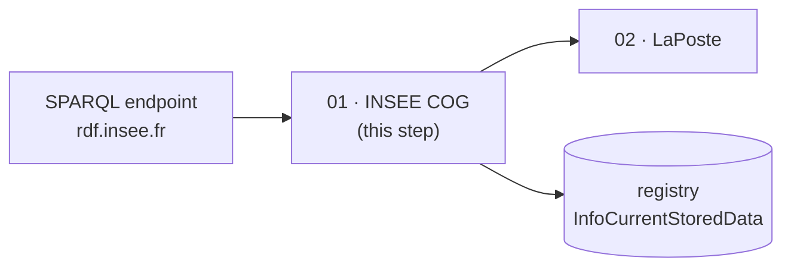
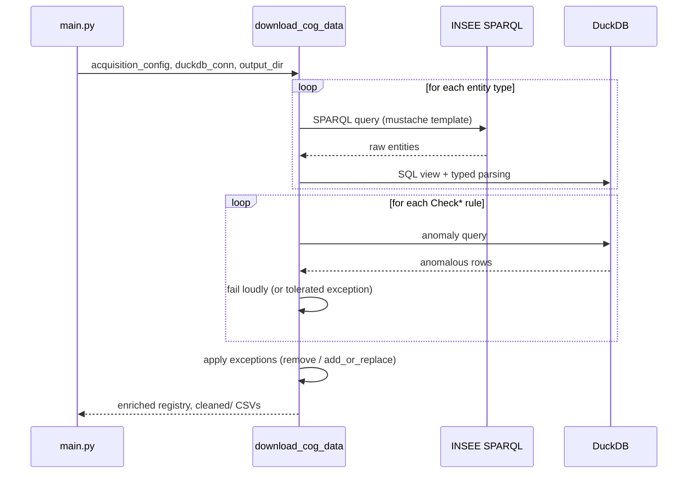

# Step 01 — Download the INSEE COG

!!! abstract "Summary"
    Queries the INSEE COG SPARQL endpoint to retrieve six entity types
    (communes, municipal arrondissements, departements, overseas
    collectivities, districts, countries), loads them into DuckDB and
    applies 17 quality checks before producing cleaned CSVs.

## 1. Methodological level

### Goal

Build the reference base: the complete, validated history of French
geographic entities. All downstream steps consume this data.

### Why this step

The INSEE COG is the **legal reference** of geographic entities and their
validity dates, but it is served over SPARQL, with occasional anomalies
(duplicated URIs, inconsistent dates, missing parents). Rather than
trusting the source, the collection applies a battery of checks and fails
loudly: no unvalidated data enters the pipeline. *Known and accepted*
anomalies are declared in the exceptions file (see
[Handle exceptions](../../how-to/handle-exceptions.md)) — an auditable
management decision, not silent code.

### Parameters and influence

| Parameter | Influence on the result |
|---|---|
| `insee.endpoint_url` | Changes the source (release, mirror, test endpoint) |
| `insee.max_retries`, timeouts | Network robustness only — no influence on content |
| Exceptions handler (`insee.*.root`) | Removed entities → `remove/`, corrected entities → `add_or_replace/` |

### Position in the process



## 2. Functional level

### Implementation

- Entry function: [`download_cog_data`](../../reference/processings.md)
  (`src/rnipp_geo_data_collector/processings/download_cog_data.py`)
- Requests per entity type: `acquisition/suppliers/insee/requests.py`
  (`RequestCOGCommune`, `RequestCOGArrondissementMunicipal`,
  `RequestCOGDepartement`, `RequestsCOGCollectivitesOutremer`,
  `RequestsCOGDistrict`, `RequestCOGPays`)
- Checks: `acquisition/suppliers/insee/checks/` — each `*_check` file
  implements a class inheriting from
  `DataValidationAndConsistencyInseeCog` (`checks/abstract.py`)
- SQL: `sql/*.mustashe.sql` templates rendered by pystache

### Business rules

| Rule | Wording | Source |
|---|---|---|
| `parsing` | Every column is castable to its declared type | `checks/parsing.py` |
| `not_null` | No mandatory column is empty | `checks/not_null.py` |
| `pattern` | URIs follow the expected pattern | `checks/pattern.py` |
| `start_date` / `end_date` | Dates within bounds (>= 1943, <= today), not duplicated | `checks/start_date.py`, `checks/end_date.py` |
| `uri_unicity` | One URI identifies one entity | `checks/uri_unicity.py` |
| `parent_uri_exist` | Every entity has an existing parent | `checks/parent_uri_exist.py` |
| `parent_period_*` | Parent period overlaps/contains the child's, without gap | `checks/parent_period_*.py` |
| `insee_code_overlap` | No overlapping validity for the same code | `checks/insee_code_overlap.py` |
| `date_consistency` | Start/end dates consistent with each other | `checks/date_consistency.py` |
| `events_*` | Start/end events consistent and distinct | `checks/events_*.py` |
| `apply_update` | Application of declared exceptions | `checks/apply_update.py` |

### Inputs / Outputs / Dependencies

| | Detail |
|---|---|
| **Inputs** | SPARQL endpoint, `AcquisitionConfig.insee`, `ErrorHandlerConfig.insee.*` |
| **Outputs** | `<work>/01_processing/{raw,cleaned,remove,add_or_replace}/*.csv`, updated registry |
| **Dependencies** | DuckDB (CSV parsing/casting), pystache (SQL), `InfoCurrentStoredData` |

### Detailed behaviour



## 3. Technical level

### Change the behaviour

- **New check**: create `checks/my_check.py`, inherit from
  `DataValidationAndConsistencyInseeCog`, implement `run(request,
  duckdb_conn)`, add an SQL template if needed, then reference the class in
  `download_cog_data`.
- **New entity**: add a `RequestCOG...` class in `requests.py` (following
  the existing pattern), its exceptions config in
  `acquisition/suppliers/insee/config.py`, then call it in
  `download_cog_data`.
- Checks must stay **stateless** and fail via `RuntimeError`
  with URI + row + violated rule in the message.

### Test the change

```bash
poetry run ruff check . && poetry run pyright
poetry run geo_data_collector --acquisition-config-file config/config-acquisition.yaml \
    --exceptions-handler-config-file config/config-exceptions-handler.yaml \
    --working-directory /tmp/test-cog --overwrite-working-directory
ls /tmp/test-cog/01_processing/cleaned/
```

### Update the documentation

1. Add the rule to the "Business rules" table of this card (with the source
   file).
2. Document the class in its Google-style docstring — it will appear in the
   [acquisition reference](../../reference/acquisition.md).
3. If the user-visible behaviour changes, update the
   [Handle exceptions](../../how-to/handle-exceptions.md) guide.
