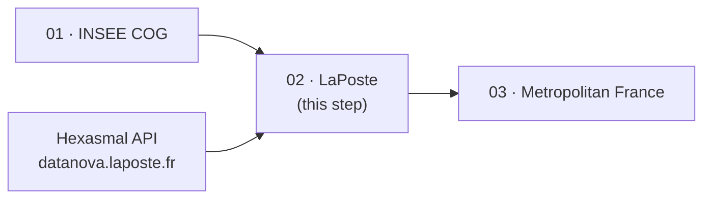
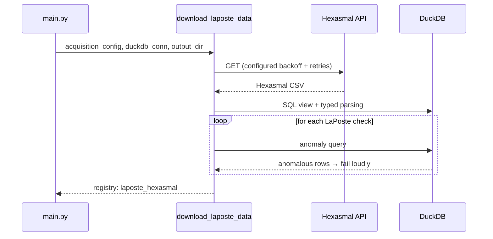

# Step 02 — Download LaPoste Hexasmal

!!! abstract "Summary"
    Downloads the LaPoste Hexasmal dataset (labels and postal codes),
    loads it into DuckDB, applies format and uniqueness checks, then
    registers it for step 05.

## 1. Methodological level

### Goal

Hold the **operational** reference of French postal codes, attached to
commune labels. This dataset is the pipeline's only postal code source.

### Why this step

The INSEE COG (step 01) knows nothing about postal codes: they belong to
LaPoste. The matching cannot be done by code (Hexasmal provides no INSEE
code) but by **label** — hence the importance of controlling label quality
at this early stage: a malformed label here would become a wrong match in
step 05.

### Parameters and influence

| Parameter | Influence on the result |
|---|---|
| `laposte.endpoint_url` | Changes the source dataset (Hexasmal or a mirror) |
| `laposte.*_timeout`, `backoff_factor`, `max_retries` | Network robustness only |
| Exceptions `laposte.root` | Manual label corrections for the matching |

### Position in the process



## 2. Functional level

### Implementation

- Entry function: [`download_laposte_data`](../../reference/processings.md)
  (`src/rnipp_geo_data_collector/processings/download_laposte_data.py`)
- Request: `RequestLaPosteHexasmal` / `OutputPathsRequestLaPosteHexasmal`
  (`acquisition/suppliers/laposte/requests.py`)
- Checks: `acquisition/suppliers/laposte/checks/` —
  `parsing.py`, `pattern.py`, `associated_name_check.py`,
  `single_associated_name_check.py`, `unique_value_by_group.py`
  (shared base: `checks/abstract.py`)
- Configuration model: `LaPosteSupplierConfig`
  (`acquisition/suppliers/laposte/config.py`)

### Business rules

| Rule | Wording | Source |
|---|---|---|
| `parsing` | Columns castable to their declared types | `checks/parsing.py` |
| `pattern` | Labels and postal codes in the expected format | `checks/pattern.py` |
| `associated_name_check` | Associated names consistent | `checks/associated_name_check.py` |
| `single_associated_name_check` | A single associated name per entity | `checks/single_associated_name_check.py` |
| `unique_value_by_group` | Value uniqueness within each group | `checks/unique_value_by_group.py` |

### Inputs / Outputs / Dependencies

| | Detail |
|---|---|
| **Inputs** | Hexasmal API (`laposte.endpoint_url`), `AcquisitionConfig.laposte`, `ErrorHandlerConfig.laposte` |
| **Outputs** | `<work>/02_processing/*.csv` (`laposte_hexasmal` table in the registry) |
| **Dependencies** | DuckDB, `InfoCurrentStoredData`, `GeoCSVFileMetadata` |

### Detailed behaviour



## 3. Technical level

### Change the behaviour

- Follow the step 01 pattern: one check = one class in `checks/`,
  inheriting from the LaPoste base, referenced by `download_laposte_data`.
- Manual label corrections go through the declarative mechanism
  (`laposte.root`), never through code.

### Test the change

```bash
poetry run ruff check . && poetry run pyright
poetry run geo_data_collector --working-directory /tmp/test-laposte \
    --overwrite-working-directory
ls /tmp/test-laposte/02_processing/
```

### Update the documentation

1. "Business rules" table of this card.
2. Docstring of the class (referenced by the
   [acquisition API](../../reference/acquisition.md)).
3. [Handle exceptions](../../how-to/handle-exceptions.md) guide if the
   declarative mechanism evolves.
