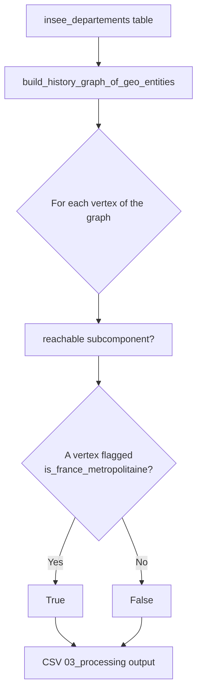

# Step 03 — Metropolitan France correction

!!! abstract "Summary"
    Corrects the `is_france_metropolitaine` boolean of the departements
    table by propagating it through the event graph: a departement is in
    metropolitan France if it is connected to an entity flagged as such.

## 1. Methodological level

### Goal

Guarantee that the `is_france_metropolitaine` column is **consistent with
the entity hierarchy**, rather than merely copied from the raw COG value,
which can be incomplete for historical entities.

### Why this step

Belonging to metropolitan France is derivable data: it propagates along the
parent/child relations between dated entities. Rather than fixing the
source data by hand (impossible: the COG is an external reference), the
correction is **recomputed at every run** on the event graph — it is
idempotent and self-healing: a new COG release gets corrected automatically.

### Parameters and influence

This step takes no user parameter. Its behaviour depends entirely on the
data validated in steps 01–02: fewer declared exceptions = a more complete
graph = more reliable corrections.

### Position in the process


## 2. Functional level

### Implementation

- Entry function: [`correct_metropolitan_france_dummy`](../../reference/processings.md)
  (`src/rnipp_geo_data_collector/processings/metropolitan_france_dummy_correction.py`)
- Helper: `_correct_record_metropolitan_france_dummy(g, id)` — walks the
  connected component of the vertex (`g.subcomponent(id, mode="ALL")`)
  and returns `True` as soon as a flagged entity is reached.
- Graph: [`build_history_graph_of_geo_entities`](../../reference/graph.md)
  called on the `insee_departements` table.

### Business rules

| Rule | Wording | Source |
|---|---|---|
| Propagation | `is_france_metropolitaine = True` iff a reachable vertex in the graph carries `True` | `_correct_record_metropolitan_france_dummy` |
| Column-wise copy | All other columns are copied verbatim | CSV writing loop |
| Fail loudly | Any CSV column missing from the vertex is an error | `KeyError` handling → `RuntimeError` |

### Inputs / Outputs / Dependencies

| | Detail |
|---|---|
| **Inputs** | `insee_departements` table (registry), DuckDB |
| **Outputs** | `<work>/03_processing/departements.csv`, updated registry |
| **Dependencies** | `graph/graph_event.py`, igraph, `GeoCSVFileMetadata` |

### Detailed behaviour



## 3. Technical level

### Change the behaviour

- The propagation semantics live in
  `_correct_record_metropolitan_france_dummy`: it is the only function to
  touch to change the rule (traversal mode, flag attribute).
- The function is deliberately isolated and pure (graph + id → bool): it
  can be tested without DuckDB.

### Test the change

```bash
poetry run ruff check . && poetry run pyright
poetry run geo_data_collector --working-directory /tmp/test-mf \
    --overwrite-working-directory
python -c "
import csv
rows = list(csv.DictReader(open('/tmp/test-mf/03_processing/departements.csv')))
print(sum(r['is_france_metropolitaine'] == 'True' for r in rows), 'metropolitan departements')
"
```

### Update the documentation

1. The "Business rules" table and diagram of this card if the semantics
   change.
2. The docstring of `correct_metropolitan_france_dummy` (rendered in the
   [processings API](../../reference/processings.md)).
3. If a CLI option is added, update the [CLI reference](../../reference/cli.md)
   and the "Parameters and influence" table.
