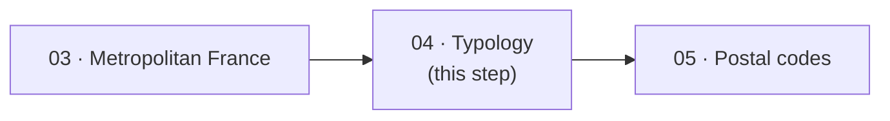

# Step 04 — Communes typology

!!! abstract "Summary"
    Adds the `location_typology` column to the communes table by combining
    explicit location rules (`LocationRule`) and fuzzy label matching
    (rapidfuzz) on the event graph.

## 1. Methodological level

### Goal

Classify every commune under a location typology (for example:
continental, Corsica, overseas...), for all its historical versions —
including when the label has changed.

### Why this step

The typology does not exist in the COG: it is **derived** from the
geographic hierarchy (departement, collectivity) in which the commune sits.
Two complementary approaches:

- **explicit rules** (`LocationRule`) for the certain cases —
  deterministic, verifiable;
- **fuzzy label matching** (rapidfuzz, accent and hyphen normalisation
  through `normalize_location_label`) for the cases where no rule applies —
  because a postal or historical label slightly differs from the INSEE
  label.

The "strict label equality" alternative was rejected: the matching rate on
compound labels (hyphens, parentheses, accents) is too low.

### Parameters and influence

No dedicated CLI parameter. The result depends on the tables validated in
step 01 (notably `insee_communes`, `insee_departements`,
`insee_collectivites_outremer`) and on the similarity threshold hard-coded
in `is_label_location_similar`.

### Position in the process



## 2. Functional level

### Implementation

- Entry function: [`typologize_communes`](../../reference/processings.md)
  (`src/rnipp_geo_data_collector/processings/communes_typology.py`)
- Rules: `LocationRule` class (NamedTuple) + `_match_location_rule`; the
  rule set is built by `compute_location_typologies`
- Fuzzy matching: `normalize_location_label`, `is_label_location_similar`
  (rapidfuzz `fuzz`)
- Graph: [`build_history_graph_of_geo_entities`](../../reference/graph.md)
  on tables `insee_communes`, `insee_departements`,
  `insee_collectivites_outremer`

### Business rules

| Rule | Wording | Source |
|---|---|---|
| Type from URI | The entity type is derived from the URI prefix (`GEO_ENTITY_URI_PREFIX`) | `entity_type_from_uri` |
| Rules first | An explicit rule (`LocationRule`) takes precedence over fuzzy matching | `compute_location_typologies` |
| Fuzzy matching | Two normalised labels are "similar" above the threshold | `is_label_location_similar` |
| Schema guards | `parent_uri` must be a `StringListColumnDataType`, `uri` a `StringColumnDataType` | `TypeError` guards |

### Inputs / Outputs / Dependencies

| | Detail |
|---|---|
| **Inputs** | Tables `insee_communes`, `insee_departements`, `insee_collectivites_outremer` (registry), DuckDB |
| **Outputs** | `<work>/04_processing/communes.csv` with the `location_typology` column, updated registry |
| **Dependencies** | `graph/graph_event.py`, igraph, rapidfuzz, unicodedata |

### Detailed behaviour

```mermaid
flowchart TD
    A[INSEE tables<br/>(communes, departements, COM)] --> B[Event graph]
    B --> C{For each commune}
    C --> D{A LocationRule<br/>applies?}
    D -- Yes --> E[Rule typology]
    D -- No --> F[Fuzzy matching<br/>normalised label]
    F --> G{Similar label<br/>found?}
    G -- Yes --> H[Matched label typology]
    G -- No --> I[Undetermined typology]
    E --> J[CSV 04_processing<br/>+ registry]
    H --> J
    I --> J
```

## 3. Technical level

### Change the behaviour

- **Add/remove a typology**: edit the `LocationRule` set built in
  `compute_location_typologies` — rules are data, not scattered code.
- **Tune tolerance**: the similarity threshold lives in
  `is_label_location_similar`; document it here if changed.
- `normalize_location_label` / `is_label_location_similar` are pure
  functions: testable without DuckDB.

### Test the change

```bash
poetry run ruff check . && poetry run pyright
poetry run geo_data_collector --working-directory /tmp/test-typo \
    --overwrite-working-directory
python -c "
import csv
rows = list(csv.DictReader(open('/tmp/test-typo/04_processing/communes.csv')))
from collections import Counter
print(Counter(r['location_typology'] for r in rows))
"
```

### Update the documentation

1. "Business rules" table and diagram if the rule/fuzzy order changes.
2. Docstrings of the functions (rendered in the
   [processings API](../../reference/processings.md)).
3. If a rule changes a user-visible result, flag it in
   [Methodology](../methodology.md) (design decisions table).
