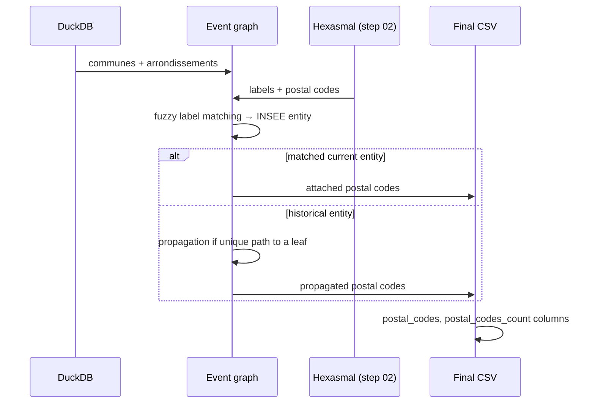

# Step 05 — Postal codes merge

!!! abstract "Summary"
    Matches LaPoste Hexasmal labels (step 02) with INSEE entities (step 01)
    to add the `postal_codes` and `postal_codes_count` columns to the
    communes and municipal arrondissements tables, including historical
    entities.

## 1. Methodological level

### Goal

Attach to every geographic entity — present or past — the postal codes
covering it. This is the pipeline's final output for the "geolocation by
postal code" use case.

### Why this step

Hexasmal provides **no INSEE code**: the matching is done by label. Two
difficulties:

1. labels evolve (merges, renamings) — hence the event graph to propagate a
   postal code to the historical versions of the same entity;
2. one label can match several entities — hence the disambiguation rules
   (unique path to a graph leaf,
   `path_to_leaf_is_unique_in_and_out`).

The "postal code → current commune only" alternative was rejected: it
loses all historical information, which is the very purpose of the project.

### Parameters and influence

No dedicated CLI parameter. The result depends on Hexasmal label quality
(checked in step 02), the declarative `laposte.root` exceptions and the
fuzzy matching threshold.

### Position in the process


## 2. Functional level

### Implementation

- Entry function: [`merge_postal_codes`](../../reference/processings.md)
  (`src/rnipp_geo_data_collector/processings/postal_codes_merge.py`)
- Key functions: `get_postal_codes_current_geo_entity`,
  `get_postal_codes_historical_geo_entity`,
  `match_hexasmal_labels_to_insee_labels`,
  `extract_hexasmal_labels_from_hexasmal_infos`,
  `path_to_leaf_is_unique_in_and_out`, `get_leaves_geo_entity_graph`
- Graph: [`build_history_graph_of_geo_entities`](../../reference/graph.md)
  on `insee_communes`, `insee_arrondissements_municipaux`
- Matching: `normalize_location_label` / `is_label_location_similar`
  (rapidfuzz)

### Business rules

| Rule | Wording | Source |
|---|---|---|
| Label matching | Hexasmal label ≈ INSEE label after normalisation | `match_hexasmal_labels_to_insee_labels` |
| Current entities | Postal codes attached to the matched current entity | `get_postal_codes_current_geo_entity` |
| Historical entities | Propagation to ancestors when the path to the leaf is unique | `get_postal_codes_historical_geo_entity`, `path_to_leaf_is_unique_in_and_out` |
| Ambiguity | A label matching several entities without disambiguation is not attributed | guards in the matching |
| Count | `postal_codes_count` = cardinality of the attributed codes | final write |

### Inputs / Outputs / Dependencies

| | Detail |
|---|---|
| **Inputs** | Tables `insee_communes`, `insee_arrondissements_municipaux`, `laposte_hexasmal` (registry), DuckDB |
| **Outputs** | `<work>/05_processing/*.csv` with `postal_codes`, `postal_codes_count` columns |
| **Dependencies** | `graph/graph_event.py`, igraph, rapidfuzz, `GeoEntityVertexInfo` |

### Detailed behaviour



## 3. Technical level

### Change the behaviour

- The disambiguation strategy lives in
  `path_to_leaf_is_unique_in_and_out` and
  `get_postal_codes_historical_geo_entity`: any attribution rule change
  goes through them.
- The similarity threshold is shared with step 04 — if you change it,
  change it in both places and update both cards.
- Declarative exceptions (`laposte.root`) remain the preferred mechanism
  for a specific case: do not code a one-off fix.

### Test the change

```bash
poetry run ruff check . && poetry run pyright
poetry run geo_data_collector --working-directory /tmp/test-cp \
    --overwrite-working-directory
python -c "
import csv
rows = list(csv.DictReader(open('/tmp/test-cp/05_processing/communes.csv')))
matched = sum(bool(r['postal_codes']) for r in rows)
print(f'{matched}/{len(rows)} communes with a postal code')
"
```

### Update the documentation

1. "Business rules" table and sequence diagram of this card.
2. Docstrings (rendered in the
   [processings API](../../reference/processings.md)).
3. If the matching rate changes significantly, update
   [Methodology](../methodology.md) (design decisions).
