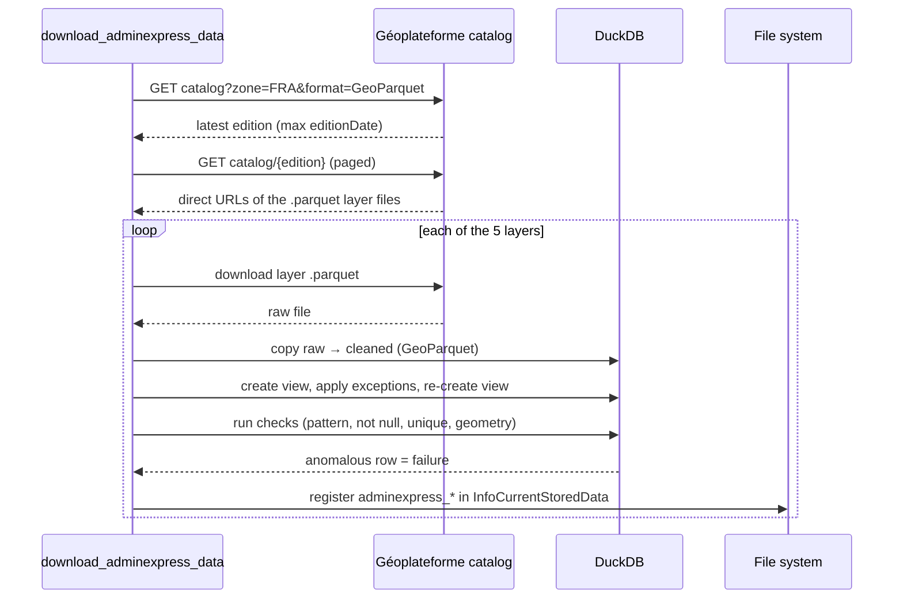

# Step 06 — Download Admin Express COG (IGN)

!!! abstract "Summary"
    Downloads the IGN **Admin Express COG** product (GeoParquet, France
    entière) and extracts the contours of the five COG entity layers —
    collectivités territoriales, arrondissements municipaux, départements,
    communes, communes associées ou déléguées — as cleaned GeoParquet files,
    validated by quality checks.

## 1. Methodological level

### Goal

Provide the **geometric contours** of the current COG entities. The INSEE
COG (step 01) is a *semantic* reference (codes, labels, dates) without
geometry; Admin Express COG is its *cartographic* counterpart, aligned on
the same COG (same INSEE codes for communes, municipal arrondissements).

### Why this step

Steps 01–05 work on codes and labels only. Any spatial question (contour,
area, "which commune contains this point") needs the IGN geometries. Admin
Express COG is preferred over the monthly ADMIN EXPRESS because it is the
edition **millésimée on the COG** (1st of January), so it is consistent with
the INSEE entities downloaded in step 01.

The GeoParquet format is requested directly from the Géoplateforme catalog:
no reprojection, no format conversion — the files are consumed as-is.

### Parameters and influence

| Parameter | Influence on the result |
|---|---|
| `adminexpress.catalog_url` | Changes the product catalog (other IGN products) |
| `adminexpress.zone` | Geographic coverage of the edition (`FRA` = France entière, DROM included) |
| `adminexpress.format` | Delivery format (`GeoParquet`, but also `GPKG`, `SHP`, `FlatGeoBuf` exist in the catalog) |
| `adminexpress.*_timeout`, `backoff_factor`, `max_retries` | Network robustness only (the commune layer is ~450 MB) |
| Exceptions `adminexpress.<layer>` | Manual corrections (`add_or_replace` / `remove`, keyed by `cleabs`) |

The **edition is not hardcoded**: at run time, the catalog is queried for
the latest edition matching `zone`/`format` (e.g.
`ADMIN-EXPRESS-COG_4-0__GEOPARQUET_WGS84G_FRA_2026-01-01`), so the pipeline
follows the annual COG updates automatically.

### Position in the process


## 2. Functional level

### Implementation

- Entry function: [`download_adminexpress_data`](../../reference/processings.md)
  (`src/rnipp_geo_data_collector/processings/download_adminexpress_data.py`)
- Requests: `RequestAdminExpressCollectiviteTerritoriale`,
  `RequestAdminExpressArrondissementMunicipal`, `RequestAdminExpressDepartement`,
  `RequestAdminExpressCommune`, `RequestAdminExpressCommuneAssocieeOuDeleguee`
  (`acquisition/suppliers/adminexpress/requests.py`)
- Checks: `acquisition/suppliers/adminexpress/checks/` — `parsing.py`,
  `pattern.py`, `not_null.py`, `unique_value.py`, `geometry_valid.py`
  (shared base: `checks/abstract.py`)
- Configuration model: `AdminExpressSupplierConfig`
  (`acquisition/suppliers/adminexpress/config.py`)
- Registry metadata: `GeoParquetFileMetadata` + `GeometryColumnDataType`
  (`metadata.py`)

### Business rules

| Rule | Wording | Source |
|---|---|---|
| Latest edition | The edition with the maximum `editionDate` in the catalog for the configured zone/format is used | `resolve_latest_edition` |
| Layer files | One GeoParquet file per layer, resolved from the edition's catalog entry | `get_layer_download_url` |
| `parsing` | Raw file readable as GeoParquet; cleaned file is re-written as GeoParquet (the `geometrie_bbox` covering struct is dropped, the bbox stays in the `geo` metadata) | `checks/parsing.py` + `sql/*_copy.mustache.sql` |
| `pattern` | `cleabs` matches `^[A-Z0-9_]+$`; `code_insee` matches the layer's code format (5-char INSEE code for communes/arrondissements, 2–3 chars for départements, IGN collectivity code for collectivités territoriales) | `checks/pattern.py` |
| `not_null` | `cleabs`, `code_insee`, `nom_officiel`, `geometrie` are never NULL | `checks/not_null.py` |
| `unique_value` | `cleabs` and `code_insee` are unique within a layer | `checks/unique_value.py` |
| `geometry_valid` | Every geometry is non-NULL, non-empty and OGC-valid (`ST_IsValid`) | `checks/geometry_valid.py` |
| Exceptions | `add_or_replace` rows are keyed by `cleabs`, geometry given as WKT (`ST_GeomFromText`); `remove` rows are dropped — both applied before the checks, so exceptions are validated too | `RequestAdminExpressCog.apply_updates` + `sql/*_correct.mustache.sql` |

### Inputs / Outputs / Dependencies

| | Detail |
|---|---|
| **Inputs** | Géoplateforme download catalog (`adminexpress.catalog_url`), `AcquisitionConfig.adminexpress`, `ErrorHandlerConfig.adminexpress`, DuckDB (spatial extension) |
| **Outputs** | `<work>/06_processing/cleaned/{collectivite_territoriale,arrondissement_municipal,departement,commune,commune_associee_ou_deleguee}.parquet`, registered as `adminexpress_*` keys in the registry |
| **Dependencies** | DuckDB + spatial extension, `InfoCurrentStoredData`, `GeoParquetFileMetadata` |

### Detailed behaviour



## 3. Technical level

### Change the behaviour

- Add a layer: new subclass of `_AdminExpressLayerRequest` in
  `requests.py` (layer filename, view name, column types, per-layer
  `code_insee` pattern) + its three `sql/<layer>_*.mustache.sql` templates +
  an entry in the `layers` list of `download_adminexpress_data`.
- Add a check: new class in `acquisition/suppliers/adminexpress/checks/`
  inheriting `DataValidationAndConsistencyAdminExpressCog`, referenced in
  `extra_controls` — SQL goes in a `sql/*.mustashe.sql` template.
- The DuckDB spatial extension is loaded by
  `init_duckdb_connection` (`utils/duckdb.py`); it is required to read and
  write GeoParquet (`GEOMETRY` columns).

### Test the change

```bash
poetry run ruff check . && poetry run pyright
poetry run geo_data_collector --working-directory /tmp/test-ae \
    --overwrite-working-directory
python -c "
import duckdb
con = duckdb.connect(); con.load_extension('spatial')
for layer in ['commune', 'commune_associee_ou_deleguee', 'departement', 'arrondissement_municipal', 'collectivite_territoriale']:
    n = con.execute(f\"SELECT count(*) FROM read_parquet('/tmp/test-ae/06_processing/cleaned/{layer}.parquet')\").fetchone()[0]
    print(layer, n)
"
```

### Update the documentation

1. "Business rules" table and sequence diagram of this card.
2. Docstrings (rendered in the
   [processings API](../../reference/processings.md) and
   [acquisition API](../../reference/acquisition.md)).
3. [Configuration reference](../../reference/configuration.md) if a new
   `adminexpress.*` parameter appears.
