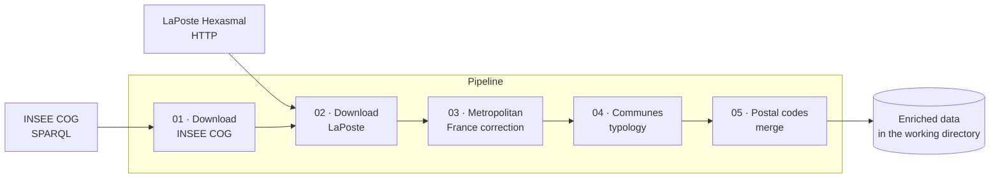

# Geo Collect — geographic data collector

**geo-collect** assembles the history of French geographic entities
(communes, municipal arrondissements, départements, overseas collectivities,
districts, countries) from the [INSEE COG](https://www.insee.fr/en/information/2560452)
and [LaPoste Hexasmal](https://datanova.laposte.fr/data-fair/api/v1/datasets/laposte-hexasmal/raw)
datasets, then enriches them (location typology, postal codes).

## Three readings of the same documentation

This documentation follows the [Diátaxis](https://diataxis.fr/) framework and
serves three audiences:

| Audience | Question | Where to look |
|---|---|---|
| **User** | What are the process steps, why were they chosen, how do parameters influence results? | [Tutorial](tutorials/first-run.md), [How-to guides](how-to/configure-acquisition.md), [Methodology](explanation/methodology.md) |
| **Developer** | Where is this step implemented, which business rules does it apply, what are its dependencies? | [Step cards](explanation/steps/step-card-template.md), [API reference](reference/cli.md) |
| **Contributor** | How to change the behaviour, test the change and update the documentation without inconsistencies? | [Contributing](contributor/modify-a-step.md) |

## The process at a glance



## Quick start

```bash
pip install -e .
geo_data_collector \
    --acquisition-config-file "./config/config-acquisition.yaml" \
    --exceptions-handler-config-file "./config/config-exceptions-handler.yaml" \
    --overwrite-working-directory
```

The [First run](tutorials/first-run.md) tutorial walks through every option.
