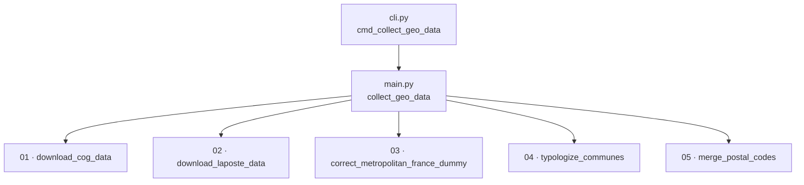

# CLI reference

The entry point is `geo_data_collector` (declared in `pyproject.toml` →
`rnipp_geo_data_collector.cli:app`), built with
[Typer](https://typer.tiangolo.com/).

## Command

```text
geo_data_collector [OPTIONS]
```

## Options

| Option | Default | Description |
|---|---|---|
| `--acquisition-config-file PATH` | `None` | Acquisition configuration file (YAML/JSON). If absent: code defaults. |
| `--exceptions-handler-config-file PATH` | `None` | Exceptions file (ignored/corrected). |
| `--working-directory PATH` | `./output` | Output and temporary working directory. |
| `--overwrite-working-directory / --no-overwrite-working-directory` | `False` | Allow deleting the directory if it already exists. |
| `--threads INT` | `1` | DuckDB threads. |
| `--duckdb-extension-directory PATH` | `None` | DuckDB extensions directory. |
| `--duckdb-memory-limit TEXT` | `10GB` | DuckDB memory limit. |
| `--duckdb-max-temp-directory-size TEXT` | `50GB` | Max size of the DuckDB temporary directory. |
| `--loglevel TEXT` | `INFO` | Logging level (`DEBUG`, `INFO`, `WARNING`, `ERROR`). |
| `--log-stdout / --no-log-stdout` | `True` | Emit logs to standard output. |
| `--log-file PATH` | `None` | Also write logs to this file. |

## Orchestration



## Generated code documentation

::: rnipp_geo_data_collector.cli
    options:
      members:
        - cmd_collect_geo_data

::: rnipp_geo_data_collector.main
    options:
      members:
        - collect_geo_data
