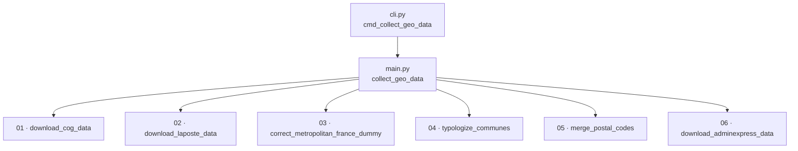

# CLI reference

The entry point is `geo_data_collector` (declared in `pyproject.toml` →
`rnipp_geo_data_collector.cli:app`), built with
[Typer](https://typer.tiangolo.com/).

## Command

```text
geo_data_collector [OPTIONS]
```

## Options

| Option | Default | Description |
|---|---|---|
| `--acquisition-config-file PATH` | `None` | Acquisition configuration file (YAML/JSON). If absent: code defaults. |
| `--exceptions-handler-config-file PATH` | `None` | Exceptions file (ignored/corrected). |
| `--working-directory PATH` | `./output` | Output and temporary working directory. |
| `--overwrite-working-directory / --no-overwrite-working-directory` | `False` | Allow deleting the directory if it already exists. |
| `--offline / --no-offline` | `False` | Do not download anything: all acquisition sources (insee, laposte, adminexpress) read the raw files provided in `--offline-data-directory`. |
| `--offline-data-directory PATH` | `None` | Directory of pre-downloaded raw files, one sub-directory per source (`<dir>/insee/`, `<dir>/laposte/`, `<dir>/adminexpress/`). Required with `--offline` or `--offline-sources`; rejected without them. |
| `--offline-sources TEXT` | `None` | Comma-separated subset of sources to read offline from `--offline-data-directory` (`insee`, `laposte`, `adminexpress`), e.g. `adminexpress` or `insee,laposte`. The other sources are downloaded as usual (partial offline mode). Mutually exclusive with `--offline`. |
| `--threads INT` | `1` | DuckDB threads. |
| `--duckdb-extension-directory PATH` | `None` | DuckDB extensions directory. |
| `--duckdb-memory-limit TEXT` | `10GB` | DuckDB memory limit. |
| `--duckdb-max-temp-directory-size TEXT` | `50GB` | Max size of the DuckDB temporary directory. |
| `--loglevel TEXT` | `INFO` | Logging level (`DEBUG`, `INFO`, `WARNING`, `ERROR`). |
| `--log-stdout / --no-log-stdout` | `True` | Emit logs to standard output. |
| `--log-file PATH` | `None` | Also write logs to this file. |

## Orchestration



## Offline mode

Offline mode is **per source**. Each acquisition source reads its raw files
from `--offline-data-directory` instead of downloading them; the usual
content checks then run on them. Steps 03–05 never download anything and
are unaffected.

| Source | Step | Files read from |
|---|---|---|
| `insee` | 01 — INSEE COG | `<dir>/insee/` (7 CSV) |
| `laposte` | 02 — LaPoste Hexasmal | `<dir>/laposte/laposte_hexasmal.csv` |
| `adminexpress` | 06 — Admin Express COG | `<dir>/adminexpress/` (5 GeoParquet) |

The sub-directories are named after the sources — not after the processing
order — so the layout does not depend on the runtime step numbering:

```text
<offline-data-directory>/
├── insee/         # communes.csv, departements.csv, ... (7 files)
├── laposte/       # laposte_hexasmal.csv
└── adminexpress/  # commune.parquet, departement.parquet, ... (5 files)
```

To build such a directory from a previous run, copy or link the `raw/`
folders of the old working directory under their source name:

```bash
mkdir -p raw-data/insee raw-data/laposte raw-data/adminexpress
cp output/01_processing/raw/*.csv raw-data/insee/
cp output/02_processing/raw/*.csv raw-data/laposte/
cp output/06_processing/raw/*.parquet raw-data/adminexpress/
```

### Fully offline

`--offline` reads **all** sources from the directory:

```bash
geo_data_collector \
    --acquisition-config-file ./config/config-acquisition.yaml \
    --exceptions-handler-config-file ./config/config-exceptions-handler.yaml \
    --working-directory ./output-offline --overwrite-working-directory \
    --offline --offline-data-directory ./output
```

### Partially offline (per source)

`--offline-sources` selects a comma-separated subset of sources; the others
are downloaded as usual:

```bash
# IGN contours provided locally, INSEE and LaPoste downloaded:
geo_data_collector ... --offline-sources adminexpress \
    --offline-data-directory ./output

# INSEE and LaPoste provided locally, IGN downloaded:
geo_data_collector ... --offline-sources insee,laposte \
    --offline-data-directory ./output
```

`--offline` and `--offline-sources` are mutually exclusive.

A missing raw file for an offline source stops the run with an explicit
message naming the file and the directory; the download is never attempted
as a fallback for that source.

## Generated code documentation

::: rnipp_geo_data_collector.cli
    options:
      members:
        - cmd_collect_geo_data

::: rnipp_geo_data_collector.main
    options:
      members:
        - collect_geo_data
