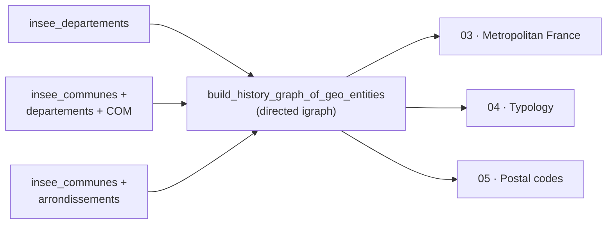

# Graph API

Module `rnipp_geo_data_collector.graph`: the event graph shared by steps
03, 04 and 05.

::: rnipp_geo_data_collector.graph.graph_event

## Role in the pipeline

The graph is directed: dated edges link every entity to its start and end
events. Any historical question ("who existed when", "who descends from
whom") becomes a graph traversal. See the
[technical architecture](../explanation/architecture.md).
